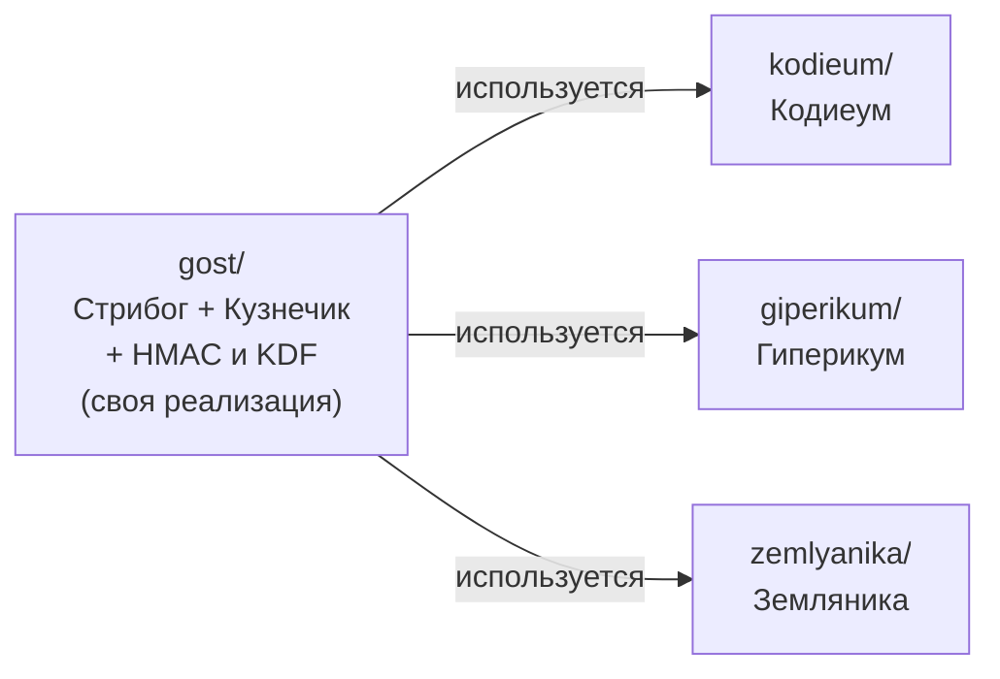

# Как устроен проект EProj — простыми словами

## Коротко

- **Что это:** учебная практика команды из трёх человек (Авилов Алексей,
  Козлов Дмитрий, Гулиева Юлия, АВТ-551). Нужно запрограммировать три
  новых криптографических алгоритма из документов ТК 26 и проверить,
  что документы описывают их правильно.
- **Этап 1 (готов):** руководитель попросил сначала самим написать
  два базовых ГОСТ-алгоритма — хэш-функцию «Стрибог» и шифр «Кузнечик».
  Это сделано и проверено, лежит в папке [`gost/`](gost/).
- **Этап 2 (готов):** «Кодиеум» написан заново целиком на наших
  «Стрибоге» и «Кузнечике», без чужих криптобиблиотек, и сверен с
  примерами документа.
- **Этап 3 (готов):** подпись «Гиперикум» на нашем «Стрибоге», все шесть
  наборов параметров, сверена с примерами документа.
- **Этап 4 (готов):** «Земляника» на нашем «Стрибоге», все четыре набора
  параметров. Контрольных примеров в её документе нет, поэтому проверена
  самосогласованность и размеры из таблицы документа.

## Зачем всё это

Почти все сообщения в интернете защищены шифрами, которые держатся на
том, что некоторые математические задачи очень долго решать. Обычному
компьютеру на взлом понадобились бы миллионы лет. Квантовый компьютер
решает именно эти задачи быстро. Поэтому придумывают **постквантовые**
алгоритмы — «замки» на другой математике, которую квантовый компьютер не
ускоряет.

ТК 26 (технический комитет по криптографии) выпустил проекты
методических рекомендаций (МР) — описания трёх таких алгоритмов. Наша
задача — написать по ним программу, проверить её на примерах из
документов и найти в документах неточности.

Все три алгоритма собраны из готовых «кирпичиков» — российских стандартов
«Стрибог» и «Кузнечик». Поэтому кирпичики делаются первыми.

## Карта репозитория

```
EProj/
├── README.md              ← вход в проект: что где лежит
├── PROJECT_OVERVIEW.md    ← этот файл
├── REPORT.md              ← отчёт по проекту (пишется по ходу работы)
├── schemes.svg            ← картинка: схемы всех трёх вариантов
├── PRESENTATION_GUIDE.md  ← шпаргалка к встрече (только локально, не в git)
│
├── gost/                  ← ЭТАП 1: свои «Стрибог», «Кузнечик», HMAC и KDF
├── kodieum/               ← ЭТАП 2: вариант «Кодиеум» на gost/
├── giperikum/             ← ЭТАП 3: вариант «Гиперикум» на gost/
├── zemlyanika/            ← ЭТАП 4: вариант «Земляника» на gost/
│
├── Dockerfile             ← запуск main.py в Docker
├── .dockerignore          ← что не копировать в Docker-образ
├── main.py                ← единая точка входа: прогоны примеров всех частей
├── requirements.txt       ← зависимости: только pytest для тестов
└── .gitignore             ← что не отправлять в git
```

## Как части связаны между собой



«Кодиеум» берёт Стрибог, Кузнечик и KDF из нашей папки `gost/`.
«Гиперикум» и «Земляника» берут из `gost/` Стрибог.

---

## Папка `gost/` — этап 1: «Стрибог» и «Кузнечик»

### Что это простыми словами

- **«Стрибог» (ГОСТ 34.11-2018) — хэш-функция.** Как мясорубка: на вход
  любой текст, на выход «отпечаток» фиксированной длины, 256 или 512 бит.
  Один и тот же текст всегда даёт один и тот же отпечаток. Изменишь одну
  букву — отпечаток изменится целиком. А по отпечатку восстановить текст
  невозможно.
- **«Кузнечик» (ГОСТ 34.12-2018) — блочный шифр.** Замок для кусочка
  данных ровно в 16 байт: с секретным ключом (32 байта) кусочек
  превращается в «кашу», с тем же ключом — обратно.

Оба написаны с нуля на Python, без сторонних криптобиблиотек. Каждое
преобразование из стандарта — отдельная функция с той же формулой в
описании, поэтому код можно читать прямо рядом со стандартом.

### Файлы

| Файл | За что отвечает |
|---|---|
| [`sbox.py`](gost/sbox.py) | Таблица замены байтов π (256 чисел) и обратная к ней. Таблица одна и та же в обоих стандартах, поэтому вынесена отдельно |
| [`streebog.py`](gost/streebog.py) | Стрибог целиком: константы, преобразования S (замена байтов), P (перестановка байтов), L (перемешивание битов), внутренний шифр E, функция сжатия g_N и вся процедура хэширования. Главные функции — `streebog256()` и `streebog512()` |
| [`kuznechik.py`](gost/kuznechik.py) | Кузнечик целиком: умножение в поле GF(2⁸), преобразования S, R, L и обратные к ним, получение 10 раундовых ключей из основного, шифрование и расшифрование. Главное — класс `Kuznechik` с методами `encrypt()` и `decrypt()` |
| [`tests/test_streebog.py`](gost/tests/test_streebog.py) | 22 теста Стрибога: оба контрольных примера стандарта по шагам и сверка с независимой реализацией на 10 длинах сообщений |
| [`tests/test_kuznechik.py`](gost/tests/test_kuznechik.py) | 28 тестов Кузнечика: все промежуточные значения контрольного примера, расшифрование обращает шифрование, отказ на неверных длинах, сверка с независимой реализацией |
| [`kdf.py`](gost/kdf.py) | HMAC и KDF_TREE на нашем Стрибоге: из одного секрета вырабатывают сколько угодно новых псевдослучайных байтов. Нужны «Кодиеуму» |
| [`tests/test_kdf.py`](gost/tests/test_kdf.py) | 12 тестов HMAC и KDF_TREE по официальным примерам RFC 7836 |
| [`examples.py`](gost/examples.py) | Наглядный прогон: печатает входные данные, ответ из стандарта и ответ программы. Запуск: `python -m gost.examples` из корня |
| [`tests/conftest.py`](gost/tests/conftest.py) | Служебный: подсказывает тестам, где искать модули |
| [`README.md`](gost/README.md) | Описание папки, порядок байтов, таблица контрольных примеров, найденные опечатки в RFC 7801 |
| [`requirements.txt`](gost/requirements.txt) | Что поставить для тестов: только `pytest` |

### Как понять, что всё работает

**Контрольный пример** — это как ответ в конце задачника: стандарт даёт
входные данные и правильный результат. **Тест** — маленькая программа,
которая сама подставляет данные и сравнивает ответ. Все 63 теста
проходят (51 Стрибога и Кузнечика и 12 HMAC/KDF). Совпадают не только итоговые ответы, но и все промежуточные
шаги из стандартов.

### Что нашли по пути

В RFC 7801 (английском переводе стандарта Кузнечика) две опечатки: в
формуле ℓ и в формуле расшифрования. Если запрограммировать формулы
буквально, контрольный пример не сходится. Подробно — в
[`gost/README.md`](gost/README.md) и в разделе 4 [`REPORT.md`](REPORT.md).

---

## Папка `kodieum/` — вариант «Кодиеум»

### Что это простыми словами

«Кодиеум» — **механизм инкапсуляции ключа** (KEM): способ для двух людей,
A и B, договориться об общем секретном ключе, переписываясь у всех на
виду.

Идея: B берёт случайный набор «ошибок» — двоичный вектор, в котором ровно
t единиц, — и отправляет A «испорченную» версию по открытому ключу A.
Только A с секретным ключом знает, как найти, где были ошибки. Из этого
набора ошибок обе стороны получают одинаковый секретный ключ. Тот, кто
подслушал, видит только испорченную версию и найти ошибки не может.
Математика — коды Гоппы, исправляющие ошибки (та же идея, что в
CD-дисках, которые «чинят» царапины).

Три основных процесса:

1. **KeyGen** (сторона A) — создаёт пару ключей: открытый (можно всем
   показать) и секретный.
2. **Encaps** (сторона B) — по открытому ключу создаёт общий секрет и его
   «упаковку» (шифртекст), упаковку отправляет A.
3. **Decaps** (сторона A) — по секретному ключу распаковывает и получает
   тот же общий секрет.

Есть три набора параметров по уровню стойкости, основной —
`secparam1264`: n = 3520, m = 12, t = 64.

Весь код написан заново по документу и использует только нашу папку
`gost/`: Кузнечик — чтобы перемешать числа в случайном порядке, KDF —
чтобы из одного секрета получить нужные случайные строки, Стрибог — чтобы
получить итоговый общий ключ.

### Файлы

| Файл | За что отвечает |
|---|---|
| [`params.py`](kodieum/params.py) | Три набора параметров из документа и проверка, что они согласованы |
| [`field.py`](kodieum/field.py) | Арифметика в поле F₂ᵐ: «числа» из m бит со своими правилами сложения и умножения. Фундамент кодов Гоппы |
| [`vectors.py`](kodieum/vectors.py) | Как длинный двоичный вектор хранится в программе, переводится в байты и записывается в стиле документа |
| [`primitives.py`](kodieum/primitives.py) | Мостик к `gost/`: Стрибог, Кузнечик и KDF в том виде, в каком их ждёт документ |
| [`auxiliary.py`](kodieum/auxiliary.py) | Два помощника: `gen_unique_seq` — n разных чисел (через Кузнечик), `gen_weight_vec` — случайный вектор ровно с t единицами (через KDF) |
| [`decode.py`](kodieum/decode.py) | Decode — самое сложное: по «синдрому» находит, где были ошибки. Разбит на шаги так же, как в документе |
| [`goppa.py`](kodieum/goppa.py) | Матрица кода H, приведение её к виду (I ‖ A) и проверка синдрома |
| [`kem.py`](kodieum/kem.py) | Сами KeyGen, Encaps, Decaps и их варианты KeyGen2/Decaps2 |
| [`unagreed.py`](kodieum/unagreed.py) | Режим, где стороны заранее не договариваются о параметрах: n, m, t узнаются из ключей |
| [`examples.py`](kodieum/examples.py) | Наглядный прогон: по каждому значению из примеров документа печатает ожидаемое, полученное и PASS/FAIL. Запуск: `python -m kodieum.examples` |
| [`control_examples.json`](kodieum/control_examples.json) | Все контрольные значения из приложения Б документа, перенесённые программно |
| [`README.md`](kodieum/README.md) | Описание папки, запуск, версия Python, как данные подаются в Стрибог и Кузнечик, принятые трактовки |
| [`kodieum.md`](kodieum/kodieum.md) | Разбор документа: алгоритмы, параметры и ограничения, граничные случаи, представление данных |
| [`ANALYSIS.md`](kodieum/ANALYSIS.md) | Анализ качества документа: 11 предложений по улучшению в формате задания и ответы на два главных вопроса |

### Тесты (85 штук)

| Файл | Что проверяет |
|---|---|
| `test_control_examples.py` (10) | все контрольные примеры документа Б.1–Б.7, включая промежуточные значения |
| `test_field.py` (13) | арифметику поля |
| `test_vectors.py` (4) | запись и перевод векторов в байты по примерам документа |
| `test_auxiliary.py` (14) | Кузнечик в нужной записи, `gen_unique_seq`, `gen_weight_vec`, крайние длины |
| `test_kem.py` (36) | матрицы кода, поиск ошибок, полный цикл, KeyGen2/Decaps2, Стрибог-512, испорченный и нулевой шифртекст, крайние n, неверные входы |
| `test_unagreed.py` (8) | режим без согласования параметров |

### Состояние

- Полный цикл работает на всех трёх наборах параметров. Для
  `secparam1264`: одна попытка KeyGen около 0,7 с, а попыток в среднем
  нужно около четырёх; Encaps 0,01 с, Decaps 0,5 с.
- Контрольные примеры документа сходятся все, кроме одного шага: выработки
  случайных строк через KDF в Б.3 и Б.5. Наш KDF проходит официальные
  примеры RFC 7836, а значения документа не получаются ни при каком
  разумном варианте. Скорее всего, это ошибка или недоописанность в
  документе — вопрос к авторам.
- Реализованы и все варианты из документа: KeyGen2/Decaps2, режим без
  согласования параметров, общий ключ на Стрибоге-512.
- Попутно нашли, что Decode из документа иногда выдаёт «не тот» вектор
  ошибок, и добавили проверку. Это и ещё 10 замечаний — в
  [`kodieum/ANALYSIS.md`](kodieum/ANALYSIS.md).

---

## Папка `giperikum/` — вариант «Гиперикум»

**Что это:** электронная **подпись** — как печать на документе. Она
доказывает, что сообщение написал именно владелец ключа и что его никто
не подменил. Вся надёжность держится только на хэш-функции Стрибог.

**Как устроено, на пальцах:** есть «одноразовые печати» (WOTS+C), каждую
можно использовать только раз. Много таких печатей собирают в дерево
(XMSS), деревья — в дерево деревьев (гипердерево). Так одним открытым
ключом можно проверить огромное число подписей. Отдельная схема FORS+C
подписывает «отпечаток» сообщения.

### Файлы

| Файл | За что отвечает |
|---|---|
| [`params.py`](giperikum/params.py) | Шесть наборов параметров из документа и длина подписи |
| [`address.py`](giperikum/address.py) | «Адрес» ADRS — 28 байт, которые говорят, в каком месте схемы сейчас считается хэш |
| [`hashes.py`](giperikum/hashes.py) | Семь функций на Стрибоге: F, H, PRF и другие |
| [`wots.py`](giperikum/wots.py) | Одноразовая печать WOTS+C |
| [`xmss.py`](giperikum/xmss.py), [`hypertree.py`](giperikum/hypertree.py) | Деревья из печатей и дерево деревьев |
| [`fors.py`](giperikum/fors.py) | FORS+C — подпись «отпечатка» сообщения |
| [`hypericum.py`](giperikum/hypericum.py) | Сами выработка ключей, подпись и проверка |
| [`examples.py`](giperikum/examples.py) | Наглядный прогон примеров документа с PASS/FAIL: `python -m giperikum.examples` |
| [`README.md`](giperikum/README.md), [`giperikum.md`](giperikum/giperikum.md), [`ANALYSIS.md`](giperikum/ANALYSIS.md) | Описание и запуск, разбор документа, анализ качества документа (9 предложений) |

### Состояние

- Всё из документа реализовано; подпись «быстрого» набора считается от
  30 секунд до минуты, проверка — около секунды. «Маленькие» наборы на
  Python подписывать слишком долго (сотни миллионов вызовов хэша).
- С документом совпало всё, кроме двух чисел, которые оказались
  опечатками самого документа (это доказано).
- Пришлось угадывать три вещи, которых нет в тексте: в каком порядке
  кусочки данных подаются в Стрибог, что к сообщению в примерах дописан
  нулевой байт, и что «целевая сумма» в WOTS+C равна 480, а не 512, как
  написано.
- Чтобы подпись не считалась по 10 минут, Стрибог ускорили в 11 раз
  таблицами; старая «буквальная» версия осталась для сверки.

## Папка `zemlyanika/` — вариант «Земляника»

**Что это:** снова **механизм инкапсуляции ключа**, как «Кодиеум», но
на другой математике — решётках (по образцу западного стандарта Kyber /
ML-KEM). Секрет прячется за счёт специально добавленного «шума» в
матричных вычислениях.

**Как устроено, на пальцах:** сначала строится простое шифрование
(Zemlyanika.PKE). Поверх него — надстройка (Zemlyanika.KEM), которая
после расшифрования перепроверяет себя: зашифровывает результат заново и
сравнивает. Если не совпало — выдаёт правдоподобный «фальшивый» ключ
вместо ошибки, чтобы не подсказывать атакующему.

### Файлы

| Файл | За что отвечает |
|---|---|
| [`params.py`](zemlyanika/params.py) | Четыре набора параметров из таблицы документа и размеры ключей |
| [`ring.py`](zemlyanika/ring.py) | Многочлены степени до 255 «по кругу» (x²⁵⁶ = −1), векторы и матрицы из них, сжатие |
| [`prng.py`](zemlyanika/prng.py) | Генератор псевдослучайных битов по Р 1323565.1.006 на нашем Стрибоге-512 |
| [`sampling.py`](zemlyanika/sampling.py), [`encoding.py`](zemlyanika/encoding.py) | Случайная матрица A, «шум» с маленькими коэффициентами, перевод многочленов в байты |
| [`pke.py`](zemlyanika/pke.py), [`kem.py`](zemlyanika/kem.py) | Шифрование и сам механизм инкапсуляции ключа |
| [`examples.py`](zemlyanika/examples.py) | Наглядный прогон с PASS/FAIL: `python -m zemlyanika.examples` |
| [`README.md`](zemlyanika/README.md), [`zemlyanika.md`](zemlyanika/zemlyanika.md), [`ANALYSIS.md`](zemlyanika/ANALYSIS.md) | Описание и запуск, разбор документа, анализ качества документа (9 предложений) |

### Состояние

- Работает на всех четырёх наборах, каждая операция — от 7 до 30 мс.
- Документ — предварительная редакция, контрольных примеров в нём нет.
  Наборы параметров есть (таблица 1), и размеры открытого ключа и
  шифртекста с ней совпали.
- В трёх алгоритмах документа опечатки, и программа, написанная по ним
  дословно, не работает: в декапсуляции перепутано условие, при
  зашифровании матрица строится не из того, а при выработке ключа взят не
  тот параметр (это видно только в наборах Z768-C и Z1024). Сама схема
  верная: мы исправили опечатки, и всё работает. Тесты показывают,
  что ломается без исправления.
- Размер закрытого ключа в таблице документа для двух наборов не сходится
  с его же алгоритмом.

---

## Файлы в корне

| Файл | За что отвечает |
|---|---|
| [`README.md`](README.md) | Входная точка: что за проект, этап 1, таблица вариантов |
| [`REPORT.md`](REPORT.md) | Отчёт по проекту: этап 1 (стандарты, реализация, тестирование, замечания к источникам), «Кодиеум» (раздел 6), «Гиперикум» (раздел 7), «Земляника» (раздел 8), литература. Пополняется вместе с кодом |
| [`schemes.svg`](schemes.svg) | Одна картинка со схемами всех трёх вариантов: слои от математики до протокола. Открывается в браузере или прямо на GitHub |
| `PRESENTATION_GUIDE.md` | Шпаргалка к встрече 22.10: что говорить на каждом слайде, ответы на вероятные вопросы. Лежит только локально, в git не отправлена |
| `main.py` | Одна команда на всё: `python main.py` по очереди запускает наглядные прогоны «Стрибога» и «Кузнечика», «Кодиеума», «Гиперикума» и «Земляники» и в конце печатает сводку PASS/FAIL (около 15 секунд; `--full` — с полной подписью «Гиперикума») |
| `Dockerfile`, `.dockerignore`, `requirements.txt` | Запуск того же `main.py` в контейнере; `requirements.txt` — зависимости с пояснением: для самой реализации ничего не нужно, для тестов — pytest |
| `.gitignore` | Список того, что не отправляется в git: окружение, кэши, настройки IDE |

## Служебные папки (в git не попадают)

| Папка | Что это |
|---|---|
| `.venv/` | Виртуальное окружение Python с установленными пакетами: pytest и gostcrypto (только для сверочных тестов `gost/`) |
| `.idea/` | Настройки PyCharm |
| `.claude/` | Локальные настройки Claude Code |
| `.pytest_cache/`, `__pycache__/` | Кэши, создаются автоматически |
| `.git/` | История изменений git |

## Как всё запустить

Из корня проекта, с активированным окружением (`source .venv/bin/activate`):

```bash
python -m pytest
```

Это прогон всех тестов: 63 в `gost/`, 85 в `kodieum/` (из них 2
«ожидаемо не проходят» — тот самый шаг с KDF), 63 в `giperikum/` и 47 в
`zemlyanika/`. Идёт
около минуты, потому что строятся настоящие ключи и подписи. 4 долгих
теста «Гиперикума» (полные подписи, несколько минут) включаются так:
`GIPERIKUM_SLOW=1 python -m pytest giperikum/tests`. Только `gost/`,
меньше секунды:

```bash
python -m pytest gost/tests -v
```

Наглядный прогон примеров Стрибога и Кузнечика, «Кодиеума» и
«Гиперикума» (вместе около 15 секунд; `--full` у «Гиперикума» добавляет
полные подписи, несколько минут):

```bash
python -m gost.examples
python -m kodieum.examples
python -m giperikum.examples
python -m zemlyanika.examples
```

Нужен Python 3.10 или новее; проверено на 3.10.22 и 3.14.8.

## Текущее состояние

| Часть | Код | Проверка | Документы |
|---|---|---|---|
| `gost/` (этап 1) | готов | 63/63 теста, все контрольные примеры ГОСТ и RFC 7836 | README, раздел в отчёте |
| `kodieum/` (этап 2) | готов, на `gost/`, все режимы | 83 теста проходят + 2 ожидаемо нет; примеры документа: PASS 31, FAIL 5 (шаг с KDF) | README, разбор, анализ качества, раздел 6 в отчёте |
| `giperikum/` (этап 3) | готов, на `gost/`, все наборы | 63 теста проходят + 4 долгих по флагу; примеры документа: PASS 153, FAIL 2 (опечатки документа) | README, разбор, анализ качества, раздел 7 в отчёте |
| `zemlyanika/` (этап 4) | готов, на `gost/`, все наборы | 47 тестов; размеры по таблице: PASS 22, FAIL 2 (ошибка таблицы); контрольных примеров в документе нет | README, разбор, анализ качества, раздел 8 в отчёте |

## Что дальше

1. Задать авторам МР «Кодиеума» вопрос о примерах KDF в Б.3 и Б.5.
2. Задать авторам «Земляники» вопрос о контрольных примерах и об
   исправлениях алгоритмов 5, 6 и 10.
3. Дополнять [`REPORT.md`](REPORT.md) по мере работы.

## Словарик

| Слово | Простыми словами |
|---|---|
| Хэш-функция | «Мясорубка»: превращает любые данные в отпечаток фиксированной длины, обратно не восстановить |
| Блочный шифр | Замок для кусочка данных фиксированного размера: с ключом закрывается и открывается |
| KEM, инкапсуляция ключа | Способ двум сторонам получить общий секретный ключ, переписываясь открыто |
| Электронная подпись | Цифровая «печать»: доказывает автора и неизменность сообщения |
| Открытый / секретный ключ | Открытый можно раздать всем, секретный хранится только у владельца |
| Контрольный пример | «Ответ в конце задачника»: входные данные и правильный результат из документа |
| Тест | Программа, которая сама проверяет, что код выдаёт правильные ответы |
| МР | Методические рекомендации ТК 26: документы, по которым пишутся варианты |
| RFC | Открытые документы интернет-стандартов; RFC 6986 и 7801 — официальные английские переводы ГОСТ на Стрибог и Кузнечик |
| Поле GF(2⁸), F₂ᵐ | Набор «чисел» из 8 или m бит со своими правилами сложения и умножения; на нём держатся шифры и коды |
| Коды Гоппы | Способ записывать данные с запасом, чтобы потом найти и исправить ошибки; основа «Кодиеума» |
| Решётки | Математика многомерных сеток точек; основа «Земляники» |
